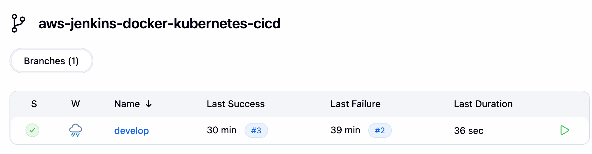
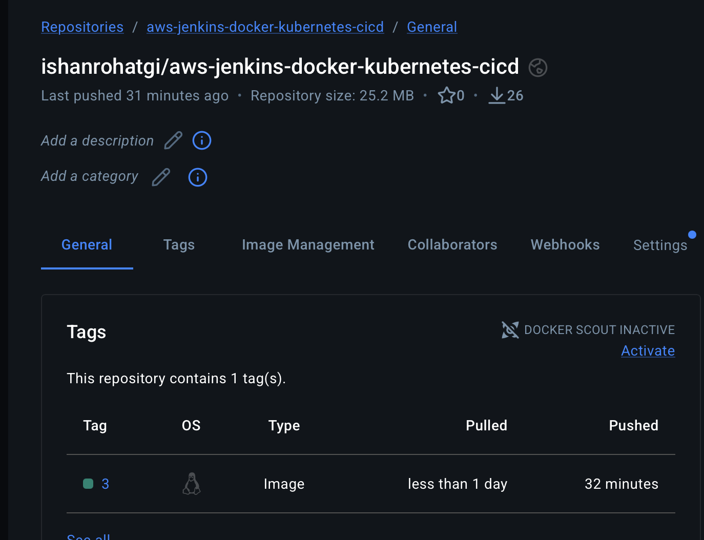
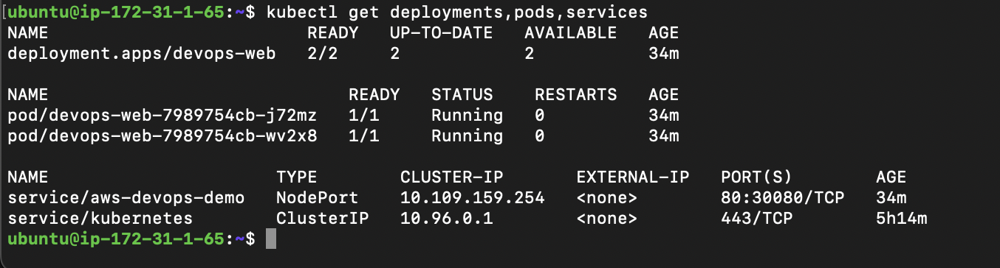
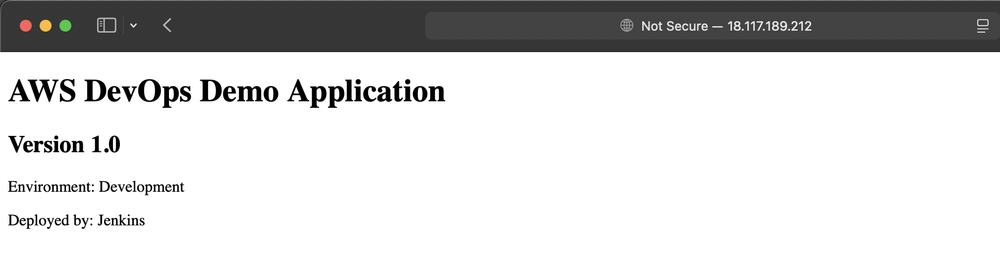

# AWS Jenkins Docker Kubernetes CI/CD

An end-to-end CI/CD project using **AWS EC2, Jenkins, Docker, Docker Hub, GitHub, and Kubernetes (Minikube)** to automate application builds and deployments.

## Architecture

```text
GitHub (develop branch)
        |
        v
Jenkins Multibranch Pipeline
        |
        v
Build Docker Image
        |
        v
Push to Docker Hub
        |
        v
SSH to Minikube EC2
        |
        v
Kubernetes Deployment
        |
        v
NGINX Application (2 replicas)
```

## Tech Stack

- **Cloud:** AWS EC2
- **CI/CD:** Jenkins Multibranch Pipeline
- **Source Control:** Git and GitHub
- **Containerization:** Docker
- **Registry:** Docker Hub
- **Orchestration:** Kubernetes with Minikube
- **Web Server:** NGINX
- **Deployment:** kubectl and SSH

## Implementation

- Provisioned separate EC2 instances for Jenkins and Minikube.
- Configured Jenkins on its built-in node without a separate agent.
- Integrated GitHub branch discovery through a Multibranch Pipeline.
- Built Docker images tagged with Jenkins build numbers.
- Pushed images to Docker Hub using Jenkins credentials.
- Automated Kubernetes deployment through SSH and kubectl.
- Deployed the application with two replicas and verified the rollout.

## Pipeline Stages

1. **Checkout:** Retrieves source code from GitHub.
2. **Build and Push:** Builds the Docker image and pushes it to Docker Hub.
3. **Deploy:** Transfers Kubernetes manifests to Minikube and updates the Deployment.
4. **Verify:** Checks the Deployment, Pods, and Services.

## Screenshots

### Jenkins Multibranch Pipeline


### Docker Hub Image


### Kubernetes Deployment


### Application Running


## Repository Structure

```text
├── Dockerfile
├── Jenkinsfile
├── README.md
├── index.html
└── k8s/
    ├── deployment.yaml
    └── service.yaml
```

## Key Learnings

- Jenkins pipeline automation and branch discovery.
- Docker image creation, tagging, and registry publishing.
- Secure credential management in Jenkins.
- SSH-based deployment to a remote Kubernetes environment.
- Kubernetes Deployments, ReplicaSets, Pods, and Services.
- Troubleshooting application connectivity across AWS, Docker, and Kubernetes.

## Future Improvements

- Configure a persistent public endpoint and HTTPS.
- Add automated tests and quality checks.
- Implement separate development and production deployment policies.
- Add monitoring with Prometheus and Grafana.
